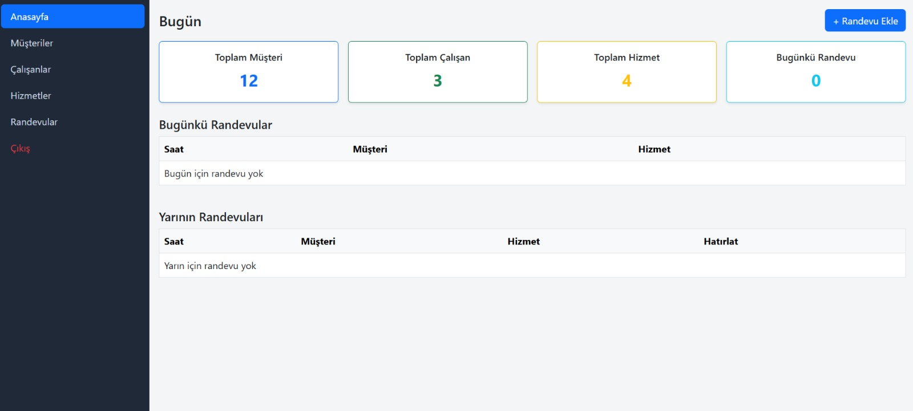
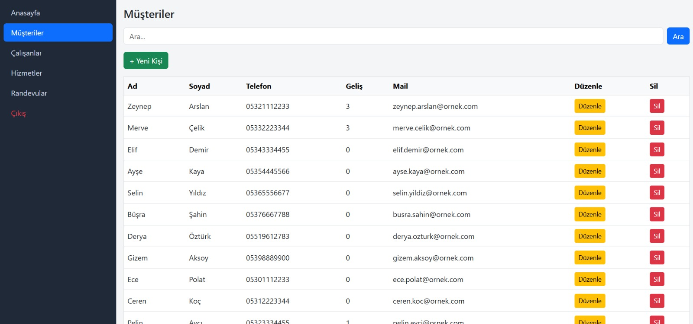
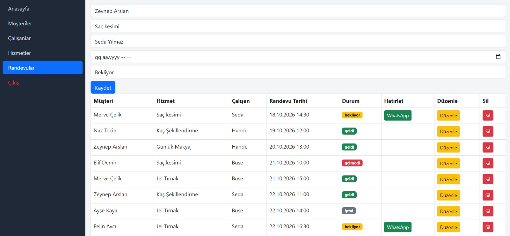
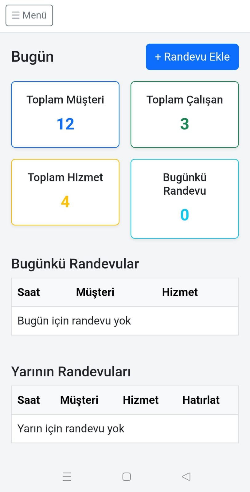

# Salon Yönetim Sistemi

PHP ve MySQL ile geliştirdiğim, bir güzellik salonunun müşteri, çalışan, hizmet ve randevu süreçlerini yönetebileceği web uygulaması.

## Ekran Görüntüleri

## Özellikler
- Müşteri, çalışan, hizmet ve randevu yönetimi (ekleme, düzenleme, silme, listeleme)
- Randevularda personel ve saat seçimi; aynı personele aynı saatte çift randevu engelleniyor
- Randevu durumu takibi (bekliyor, geldi, gelmedi, iptal); iptal edilen randevu saati meşgul etmez
- Yarının randevuları için tek tıkla WhatsApp hatırlatma mesajı (wa.me bağlantısı)
- Müşteri listesinde geliş sayısı ve ad/soyada göre arama
- Ana sayfada özet kartlar, bugünün ve yarının randevu listesi
- Oturum (session) tabanlı giriş sistemi; şifreler password_hash ile saklanır, tüm sayfalar giriş kontrolüyle korunur
- Prepared statements ile SQL injection, htmlspecialchars ile XSS koruması; telefon ve mail doğrulaması
- Bootstrap 5 ile mobil uyumlu arayüz

## Teknolojiler
PHP, MySQL, Bootstrap 5, JavaScript

## Kurulum
1. XAMPP'ı kur ve Apache ile MySQL'i başlat
2. phpMyAdmin'de `mini_adres` adında bir veritabanı oluştur
3. `veritabani.sql` dosyasını bu veritabanına içe aktar (isteğe bağlı: `demo_veri.sql` ile örnek veri)
4. Proje dosyalarını `htdocs/mini_proje` klasörüne koy
5. Bir yönetici hesabı oluştur: terminalde `php -r "echo password_hash('SIFREN', PASSWORD_DEFAULT);"` çıktısını al ve `kullanicilar` tablosuna ekle:
   `INSERT INTO kullanicilar (kullanici_adi, sifre) VALUES ('admin', 'ÇIKAN_HASH');`
6. Tarayıcıdan `localhost/mini_proje` adresine git ve giriş yap

## Geliştirme Notları
Bu projeyi geliştirirken bir AI asistanından destek aldım (kod önerileri, hata ayıklama, arayüz ve hosting kurulumu). Önerilen kodları inceleyip çalıştırarak, test ederek ve ne işe yaradığını anlayarak projeye entegre ettim.

Sonraki adımlar: kullanıcı rolleri, hizmet süresine göre çakışma kontrolü, müşterinin kendi randevusunu alabilmesi.